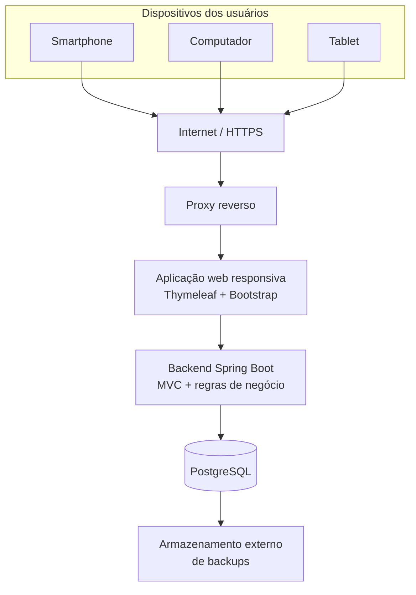
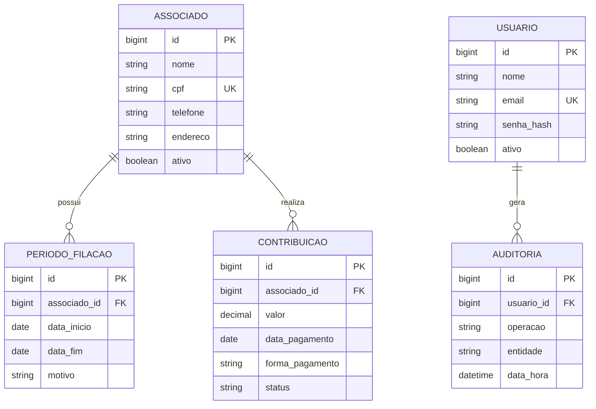
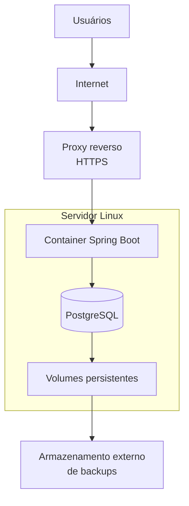
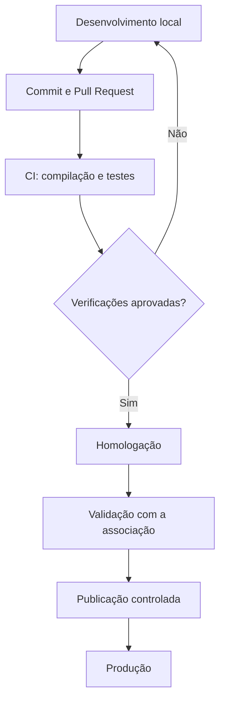

# Documento de Arquitetura de Software (DAS)

## Sistema de Gestão de Associações Comunitárias — gestao_associacao

| Informação | Descrição |
|---|---|
| Projeto | gestao_associacao |
| Natureza | Proposta de projeto de extensão universitária (PIBEX) |
| Documento | Documento de Arquitetura de Software (DAS) |
| Versão | 1.0 |
| Situação | Proposta técnica para validação |
| Data | 01/11/2026 |
| Plataforma | Aplicação web responsiva |
| Dispositivos | Smartphones, tablets e computadores |
| Conectividade | Acesso pela internet |

> **Status:** este documento descreve a arquitetura planejada. Não significa que a aplicação já esteja implementada, hospedada ou validada em produção. As decisões deverão ser confirmadas com a coordenação do projeto e os representantes da associação.

## 1. Introdução

### 1.1. Finalidade

Este Documento de Arquitetura de Software (DAS) registra a arquitetura técnica proposta para o sistema `gestao_associacao`, destinado a apoiar a gestão administrativa e financeira de associações comunitárias.

O documento orienta as decisões de tecnologia, organização interna, persistência de dados, segurança, infraestrutura, testes e implantação. Também serve como referência para desenvolvimento, manutenção e evolução do sistema.

### 1.2. Contextualização

O projeto busca responder a dificuldades de organização administrativa identificadas no contexto de uma associação comunitária, incluindo uso de fichas e documentos físicos, consulta de informações antigas, preservação do histórico de filiação e acompanhamento de contribuições.

A solução pretende centralizar informações e apoiar o trabalho da secretaria e dos representantes da associação. O sistema deverá ser desenvolvido de forma participativa, considerando os processos reais e a capacidade dos usuários.

### 1.3. Objetivo geral

Desenvolver uma aplicação web que apoie a gestão de associados, períodos de filiação e contribuições financeiras, com acesso por smartphones e computadores e preservação da integridade e do histórico das informações.

### 1.4. Objetivos específicos

- Centralizar os dados cadastrais dos associados.
- Registrar entradas, desligamentos e reativações.
- Preservar o histórico dos períodos de filiação.
- Registrar e consultar contribuições financeiras.
- Disponibilizar consultas e relatórios autorizados.
- Controlar o acesso por usuário e permissões.
- Registrar operações relevantes para fins de auditoria.
- Oferecer uma interface responsiva e acessível por navegadores modernos.
- Apoiar a organização administrativa da associação.

## 2. Escopo arquitetural

### 2.1. Escopo funcional da primeira versão

A primeira versão priorizará dois módulos de negócio:

1. **Associados e filiação:** cadastro, consulta, atualização, situação cadastral, desligamento, reativação e histórico dos períodos de filiação.
2. **Contribuições:** registro, consulta e histórico de pagamentos realizados.

Autenticação, autorização, auditoria e configuração são capacidades transversais necessárias para operar esses módulos com segurança; não devem ser confundidas com ampliação do escopo funcional principal.

Relatórios e documentos poderão ser implementados conforme os requisitos priorizados e validados com a associação.

### 2.2. Evoluções possíveis

Poderão ser avaliadas em versões futuras:

- Gestão de cobranças, mensalidades e obrigações financeiras.
- Controle de inadimplência e pagamentos parciais.
- Emissão avançada de documentos e recibos.
- Fluxo de aprovação de documentos pela presidência.
- Exportação de relatórios.
- Notificações.
- Instalação como Progressive Web App (PWA).
- Suporte a múltiplas associações.

A inclusão dessas funcionalidades dependerá de levantamento, priorização e validação com os beneficiários.

### 2.3. Fora do escopo inicial

- Aplicativos nativos independentes para Android e iOS.
- Programa desktop instalado localmente.
- Funcionamento offline ou sincronização posterior.
- Integração bancária automática.
- Processamento de pagamentos online.
- Arquitetura de microsserviços.
- Multi-tenancy, salvo decisão futura fundamentada.

## 3. Visão geral da arquitetura

### 3.1. Estilo arquitetural

Será adotada uma arquitetura **cliente-servidor**, implementada inicialmente como **monólito modular**.

O navegador será o cliente da aplicação. O servidor executará a aplicação Spring Boot, processará as regras de negócio e acessará o PostgreSQL. A aplicação será organizada em módulos para separar responsabilidades, mas será implantada inicialmente como uma unidade.

Essa escolha reduz a complexidade operacional e de desenvolvimento para o escopo inicial. Microsserviços não são recomendados nesta etapa, pois aumentariam as necessidades de infraestrutura, observabilidade e comunicação entre serviços sem benefício proporcional.

### 3.2. Diagrama geral



### 3.3. Fluxo de uma requisição

1. O usuário acessa o endereço do sistema pelo navegador.
2. A conexão HTTPS chega ao proxy reverso.
3. O proxy encaminha a requisição à aplicação Spring Boot.
4. O Spring Security verifica autenticação e autorização.
5. O controller recebe a requisição e aciona o serviço correspondente.
6. A camada de serviço aplica validações e regras de negócio.
7. O repositório acessa o PostgreSQL quando necessário.
8. A aplicação devolve uma página HTML ou uma resposta apropriada ao navegador.

O navegador não terá conexão direta com o banco de dados. O acesso aos dados será sempre intermediado pelo backend.

## 4. Tecnologias e responsabilidades

As versões exatas das dependências deverão ser fixadas no `pom.xml` durante a configuração do projeto. A tabela apresenta a linha tecnológica proposta, não uma declaração de que todas as ferramentas já estão instaladas.

| Componente | Tecnologia proposta | Responsabilidade |
|---|---|---|
| Linguagem | Java 21 | Implementação do backend |
| Framework | Spring Boot | Inicialização e integração da aplicação |
| Web | Spring MVC / Spring Web | Rotas e processamento de requisições HTTP |
| Templates | Thymeleaf | Renderização das páginas no servidor |
| Interface | HTML5, CSS3 e JavaScript | Estrutura e interação da interface |
| Responsividade | Bootstrap 5 | Layout adaptável aos dispositivos |
| Persistência | Spring Data JPA | Repositórios e acesso aos dados |
| ORM | Hibernate | Mapeamento objeto-relacional |
| Banco de dados | PostgreSQL | Persistência relacional |
| Segurança | Spring Security | Autenticação e autorização |
| Migrações | Flyway | Versionamento do esquema do banco |
| Build | Maven | Dependências e empacotamento |
| Versionamento | Git e GitHub | Histórico e colaboração |
| Testes | JUnit 5 e Mockito | Testes automatizados |
| Containers | Docker e Docker Compose | Empacotamento e execução |
| Servidor | Linux | Ambiente de hospedagem |
| Proxy reverso | Caddy ou Nginx | HTTPS e encaminhamento de requisições |

### 4.1. Estratégia de frontend

A primeira versão utilizará **Thymeleaf com Spring MVC e Bootstrap**, mantendo a interface web dentro da mesma aplicação Spring Boot. Não será necessário manter um projeto frontend independente em React ou Angular.

Essa decisão reduz a quantidade de componentes a implantar e facilita a manutenção por uma equipe pequena. JavaScript poderá ser utilizado para interações pontuais, sem transferir regras críticas de negócio para o navegador.

### 4.2. Estratégia de API

A primeira versão não depende de uma API REST pública ou de um frontend separado. O Spring MVC será utilizado para entregar páginas e processar formulários.

Caso uma integração futura, aplicativo independente ou cliente externo seja aprovado, poderão ser criados endpoints REST versionados, mantendo as regras de negócio nos serviços do backend.

## 5. Organização interna do backend

### 5.1. Módulos

- **Associado:** cadastro, consulta, atualização e situação cadastral.
- **Filiação:** períodos de vínculo, desligamentos e reativações.
- **Contribuição:** registro e consulta dos pagamentos.
- **Usuário e segurança:** contas, autenticação, perfis e permissões.
- **Auditoria:** registro de operações relevantes.
- **Relatórios:** consultas e relatórios autorizados, conforme prioridade.

Os módulos de segurança e auditoria são transversais. A separação lógica deverá permitir evolução sem criar dependências circulares.

### 5.2. Camadas

| Camada | Responsabilidade |
|---|---|
| Controller | Receber requisições e preparar respostas |
| Service | Executar regras de negócio e coordenar operações |
| Repository | Consultar e persistir dados |
| Entity | Representar entidades persistidas |
| DTO | Transportar e validar dados de entrada e saída |
| Config | Configurações da aplicação |
| Security | Autenticação e autorização |

Controllers não deverão concentrar regras de negócio. Operações que alterem dados deverão passar pela camada de serviço e utilizar transações quando necessário.

## 6. Estrutura de diretórios proposta

A estrutura abaixo é uma referência para a implementação. Poderá ser ajustada durante a criação do projeto, preservando a separação de responsabilidades.

```text
gestao_associacao/
├── src/
│   ├── main/
│   │   ├── java/br/com/associacao/
│   │   │   ├── GestaoAssociacaoApplication.java
│   │   │   ├── config/
│   │   │   ├── security/
│   │   │   ├── associado/
│   │   │   │   ├── controller/
│   │   │   │   ├── service/
│   │   │   │   ├── repository/
│   │   │   │   ├── entity/
│   │   │   │   └── dto/
│   │   │   ├── filiacao/
│   │   │   ├── contribuicao/
│   │   │   ├── usuario/
│   │   │   ├── auditoria/
│   │   │   └── relatorio/
│   │   └── resources/
│   │       ├── templates/
│   │       │   ├── associados/
│   │       │   ├── filiacao/
│   │       │   ├── contribuicoes/
│   │       │   ├── usuarios/
│   │       │   ├── relatorios/
│   │       │   └── layout/
│   │       ├── static/
│   │       │   ├── css/
│   │       │   ├── js/
│   │       │   └── images/
│   │       ├── application.properties
│   │       └── db/migration/
│   └── test/
├── docs/
├── Dockerfile
├── compose.yaml
├── pom.xml
├── .gitignore
└── README.md
```

## 7. Arquitetura de dados

### 7.1. Entidades iniciais

**Associado:** armazena os dados cadastrais e a identificação da pessoa associada.

**PeriodoFiliacao:** representa cada período de vínculo do associado com a entidade.

**Contribuicao:** registra pagamentos efetivamente realizados.

**Usuario:** representa uma conta autorizada a acessar o sistema.

**Auditoria:** registra operações relevantes executadas por usuários.

### 7.2. Diagrama conceitual



O diagrama é conceitual e não substitui o modelo lógico e físico. Tipos, nulabilidade, índices, chaves e restrições deverão ser detalhados na documentação de modelagem antes das migrations definitivas.

### 7.3. Regras de integridade

- O CPF, quando adotado como identificador, deverá ser normalizado e possuir restrição de unicidade no banco.
- Um associado poderá possuir vários períodos de filiação.
- Não poderá haver dois períodos de filiação abertos simultaneamente para o mesmo associado.
- O desligamento não deverá apagar o cadastro nem os períodos anteriores.
- A reativação deverá registrar um novo período de filiação.
- Contribuições deverão estar vinculadas ao associado correspondente.
- Correções, cancelamentos e estornos financeiros deverão preservar rastreabilidade.
- Operações financeiras deverão utilizar transações.
- Valores monetários deverão utilizar `BigDecimal` no Java e tipo `NUMERIC` no PostgreSQL.

### 7.4. Cobranças e pagamentos

A necessidade de controlar valores devidos, competências, vencimentos, pagamentos parciais e inadimplência deverá ser confirmada com a associação.

Se esses controles forem necessários, recomenda-se separar:

- **Cobranca/ObrigacaoFinanceira:** valor devido, competência, vencimento e situação.
- **Contribuicao/Pagamento:** valor efetivamente recebido, data e forma de pagamento.

Essa separação evita tratar um pagamento como se fosse a própria obrigação financeira.

## 8. Interface responsiva e acesso por dispositivos

### 8.1. Diretriz mobile-first

A interface deverá ser projetada para telas pequenas e adaptada progressivamente a telas maiores. A responsividade será requisito desde os primeiros protótipos, e não uma correção posterior.

### 8.2. Smartphones

A experiência móvel deverá priorizar:

- Navegação compacta.
- Formulários em uma coluna.
- Campos e botões adequados ao toque.
- Listas em cartões quando tabelas não couberem.
- Texto legível e contraste adequado.
- Redução de rolagem horizontal.
- Fluxos simples para cadastro e consulta.

### 8.3. Computadores e tablets

Em telas maiores, a interface poderá oferecer:

- Menu lateral.
- Tabelas com mais colunas.
- Filtros e consultas avançadas.
- Formulários em múltiplas colunas.
- Relatórios com maior densidade de informação.

### 8.4. Compatibilidade e validação

A aplicação deverá ser testada em versões atuais dos principais navegadores: Chrome, Firefox, Edge e Safari. Os testes deverão abranger Android, iOS, Windows e Linux, conforme os dispositivos disponíveis para homologação.

A compatibilidade deverá ser verificada em diferentes larguras de tela, orientação e condições de uso.

### 8.5. PWA e funcionamento offline

A primeira versão exigirá conexão com a internet para acessar dados e realizar operações. A instalação como PWA poderá ser considerada posteriormente para facilitar o acesso pela tela inicial do smartphone.

PWA não significa, por si só, funcionamento offline. Qualquer operação offline e sincronização posterior exigirá projeto específico, tratamento de conflitos e controles adicionais de segurança; não fazem parte da primeira versão.

## 9. Infraestrutura e implantação

### 9.1. Modelo de hospedagem

A aplicação será hospedada em servidor remoto acessível por domínio. Não se recomenda utilizar o computador da secretaria como servidor permanente, pois isso criaria dependência de um equipamento local e dificultaria o acesso externo.

### 9.2. Diagrama de implantação



### 9.3. Dimensionamento preliminar

Como ponto de partida para uma associação de pequeno porte, poderá ser avaliado um servidor com:

| Recurso | Referência inicial |
|---|---|
| Processador | 2 vCPUs |
| Memória | 4 GB RAM |
| Armazenamento | SSD de 40 a 60 GB |
| Sistema operacional | Ubuntu Server LTS |
| Containers | Docker Compose |

Esses números são estimativas para planejamento, não garantias de desempenho. O dimensionamento final dependerá da quantidade de associados, acessos simultâneos, consultas, relatórios, arquivos e orçamento disponível.

### 9.4. Rede e comunicação

- Todo acesso externo deverá utilizar HTTPS.
- O PostgreSQL não deverá ser exposto diretamente à internet.
- A aplicação deverá acessar o banco por rede privada ou rede interna dos containers.
- Credenciais não deverão ser armazenadas no repositório.
- Variáveis de ambiente ou mecanismo seguro equivalente deverão fornecer segredos em produção.
- Portas e serviços desnecessários deverão permanecer fechados.

### 9.5. Containers

Docker será utilizado para padronizar a execução da aplicação e do banco. Docker Compose poderá orquestrar os containers na primeira implantação.

Os dados do PostgreSQL deverão ficar em volume persistente. O ciclo de vida do container não poderá apagar os dados do banco.

## 10. Segurança e proteção de dados

### 10.1. Autenticação

Cada pessoa autorizada deverá possuir conta individual. Senhas deverão ser armazenadas com algoritmo de hash apropriado, como BCrypt ou Argon2, por meio dos mecanismos suportados pelo Spring Security.

### 10.2. Autorização

O controle de acesso será baseado em perfis e permissões. Perfis iniciais para validação:

- **Administrador:** gerencia usuários e configurações autorizadas.
- **Secretaria:** executa atividades administrativas, conforme permissões concedidas.
- **Presidência:** consulta informações e aprova documentos ou operações que dependam de sua autorização.

Esses perfis são uma proposta inicial. As responsabilidades e permissões efetivas deverão ser confirmadas com a associação. A autorização deverá ser verificada no backend, e não apenas pela ocultação de elementos da interface.

### 10.3. Medidas técnicas

- HTTPS obrigatório em produção.
- Proteção de sessão e cookies.
- Validação de entradas no servidor.
- Uso de consultas parametrizadas e mecanismos do JPA.
- Proteção CSRF para formulários e sessões baseadas em cookies.
- Controle de tentativas de autenticação.
- Tratamento seguro de erros.
- Logs sem exposição desnecessária de dados pessoais.
- Atualização periódica de dependências.
- Acesso restrito ao banco de dados.
- Auditoria de operações relevantes.

### 10.4. LGPD

O tratamento de dados deverá observar a Lei Geral de Proteção de Dados Pessoais (Lei nº 13.709/2018), incluindo finalidade, adequação, necessidade, transparência, segurança e atendimento aos direitos dos titulares.

Deverão ser definidos, com a associação e a instituição:

- Quais dados são realmente necessários.
- Finalidades e bases legais de cada tratamento.
- Papéis e responsabilidades dos agentes de tratamento.
- Pessoas autorizadas a acessar os dados.
- Política de retenção e descarte.
- Procedimentos para atender solicitações dos titulares.
- Proteção de backups e documentos exportados.

A preservação do histórico associativo deverá ser conciliada com a finalidade do tratamento e com as obrigações legais aplicáveis. Não se deverá manter informação pessoal indefinidamente sem justificativa.

## 11. Backup e continuidade

### 11.1. Estratégia

A infraestrutura deverá realizar cópias de segurança automatizadas do PostgreSQL. Como política inicial a ser validada:

- Backup diário.
- Cópias em armazenamento separado do servidor principal.
- Retenção de cópias diárias e semanais conforme orçamento e necessidade.
- Backup antes de atualizações relevantes.
- Verificação da execução e integridade das cópias.
- Testes periódicos de restauração.

### 11.2. Recuperação

Deverá existir procedimento documentado para identificar a falha, preparar o ambiente, restaurar o banco, verificar a integridade e validar a aplicação antes de liberar novamente o acesso.

A frequência, retenção e objetivos de recuperação (RPO/RTO) deverão ser definidos considerando o impacto de perda de dados, a capacidade operacional e o orçamento da associação.

## 12. Ambientes de desenvolvimento

### 12.1. Desenvolvimento

Ambiente local utilizado pela equipe para implementar funcionalidades, executar testes unitários e de integração e validar regras de negócio.

### 12.2. Homologação

Ambiente separado destinado à validação pela equipe e por representantes da associação. Deverá utilizar dados fictícios ou devidamente anonimizados, evitando a exposição de dados reais desnecessários.

### 12.3. Produção

Ambiente utilizado pela associação. Deverá possuir HTTPS, banco persistente, backups, monitoramento básico, controle de acesso e processo controlado de atualização.

Os dados de produção não deverão ser copiados para desenvolvimento sem autorização e medidas adequadas de proteção.

## 13. Testes e qualidade

### 13.1. Testes unitários

Verificar regras isoladas, incluindo:

- Validação de dados cadastrais.
- Prevenção de duplicidade.
- Regras de filiação e reativação.
- Validação de contribuições.
- Permissões de operações.

### 13.2. Testes de integração

Verificar a interação entre aplicação, banco e mecanismos de segurança:

- Persistência com PostgreSQL.
- Relacionamentos e restrições.
- Transações.
- Autenticação e autorização.
- Registro de auditoria.

### 13.3. Testes funcionais

Validar fluxos completos de cadastro, atualização, desligamento, reativação, registro de contribuição e consulta de histórico.

### 13.4. Testes de interface

Verificar responsividade, legibilidade, navegação, formulários e acessibilidade básica em smartphones, tablets e computadores.

### 13.5. Testes de segurança e recuperação

Verificar tentativas de acesso não autorizado, isolamento de permissões, exposição de informações, proteção de sessão, backups e restauração.

A execução e os resultados dos testes deverão ser registrados em `docs/testes/`. Cenários planejados não deverão ser apresentados como testes já executados.

## 14. Integração e publicação

O fluxo de desenvolvimento recomendado é:



A publicação deverá ocorrer após revisão, testes e validação das funcionalidades relevantes. Migrações de banco deverão ser versionadas e executadas de forma controlada com Flyway.

## 15. Requisitos não funcionais arquiteturais

| Requisito | Diretriz |
|---|---|
| Responsividade | Interface adaptável a smartphones, tablets e computadores |
| Disponibilidade | Acesso pela internet, sujeito à disponibilidade da hospedagem |
| Segurança | Autenticação, autorização, HTTPS e proteção de dados |
| Integridade | Restrições relacionais e transações |
| Manutenibilidade | Código modular, documentado e testado |
| Portabilidade | Empacotamento com containers |
| Escalabilidade | Possibilidade de ampliar recursos conforme a demanda |
| Rastreabilidade | Auditoria de operações relevantes |
| Recuperabilidade | Backup externo e restauração testada |
| Compatibilidade | Navegadores modernos |

Metas quantitativas de desempenho, disponibilidade e recuperação deverão ser definidas após levantamento de uso e orçamento. Não se estabelece neste documento um SLA ainda não contratado.

## 16. Riscos e limitações

| Risco | Tratamento proposto |
|---|---|
| Indisponibilidade da internet | Informar que a primeira versão exige conexão |
| Falha no servidor | Backups externos e procedimento de recuperação |
| Perda de dados | Rotina automatizada e teste de restauração |
| Acesso indevido | Autenticação, autorização e auditoria |
| Crescimento da demanda | Monitoramento e redimensionamento |
| Dificuldade de uso | Testes com beneficiários e capacitação |
| Mudança de requisitos | Validação contínua com a associação |
| Custos de hospedagem | Comparar fornecedores e planejar orçamento |
| Exposição de dados pessoais | Minimização, controle de acesso e medidas LGPD |

## 17. Decisões arquiteturais registradas

| Identificador | Decisão |
|---|---|
| ADR-001 | Adotar arquitetura cliente-servidor |
| ADR-002 | Adotar monólito modular na primeira versão |
| ADR-003 | Utilizar Java 21 e Spring Boot |
| ADR-004 | Utilizar Spring MVC, Thymeleaf e Bootstrap |
| ADR-005 | Utilizar PostgreSQL |
| ADR-006 | Utilizar Spring Data JPA e Hibernate |
| ADR-007 | Utilizar Flyway para migrações |
| ADR-008 | Utilizar Docker e Docker Compose |
| ADR-009 | Hospedar em servidor Linux |
| ADR-010 | Exigir conexão com a internet na primeira versão |
| ADR-011 | Não desenvolver aplicativo nativo inicialmente |
| ADR-012 | Implementar controle de acesso por permissões |
| ADR-013 | Manter backups fora do servidor principal |

Estas decisões são propostas para a primeira versão e poderão ser revisadas mediante justificativa técnica e validação dos requisitos.

## 18. Etapas de implementação

| Fase | Entrega |
|---|---|
| 1. Fundação | Projeto Spring Boot, configuração e banco |
| 2. Segurança | Autenticação, perfis e permissões |
| 3. Associados | Cadastro, consulta e atualização |
| 4. Filiação | Períodos, desligamento e reativação |
| 5. Contribuições | Registro e histórico financeiro |
| 6. Auditoria e relatórios | Rastreabilidade e consultas priorizadas |
| 7. Qualidade | Testes funcionais, integração e responsividade |
| 8. Homologação | Validação com representantes da associação |
| 9. Implantação | Hospedagem, HTTPS, backup e capacitação |

A sequência e o cronograma deverão ser ajustados ao plano de trabalho do PIBEX e à disponibilidade dos participantes.

## 19. Pendências para validação

Antes da implementação definitiva, deverão ser confirmados:

1. Quantidade estimada de associados e usuários simultâneos.
2. Perfis, responsabilidades e permissões.
3. Dados cadastrais estritamente necessários.
4. Regras de filiação, desligamento e reativação.
5. Regras de cobrança, contribuição e inadimplência.
6. Necessidade e fluxo de aprovação de documentos.
7. Necessidade de anexos e armazenamento de arquivos.
8. Orçamento e fornecedor de hospedagem.
9. Responsável pela administração e suporte.
10. Política de backup, retenção e restauração.
11. Responsabilidades pelo tratamento de dados pessoais.
12. Metas de disponibilidade e recuperação.

## 20. Considerações finais

A arquitetura proposta busca oferecer uma solução web centralizada, responsiva, segura e sustentável para a realidade de uma associação comunitária.

A utilização de Java, Spring Boot, Thymeleaf, Bootstrap e PostgreSQL permite desenvolver uma aplicação integrada, acessível por smartphones e computadores, sem manter aplicações independentes para cada plataforma.

O monólito modular reduz a complexidade inicial e mantém espaço para evolução. A implantação deverá ser acompanhada de validação com os usuários, capacitação, proteção dos dados e avaliação dos resultados.

O sistema é um instrumento de apoio à organização comunitária. Seu sucesso dependerá não apenas da implementação técnica, mas também da participação dos beneficiários e da adequação às rotinas reais da associação.

---

## Histórico de revisão

| Versão | Data | Descrição |
|---|---|---|
| 1.0 | 01/11/2026 | Criação da proposta de arquitetura técnica |

**Situação:** documento de proposta, sujeito à validação pela coordenação do projeto e pelos representantes da associação.
